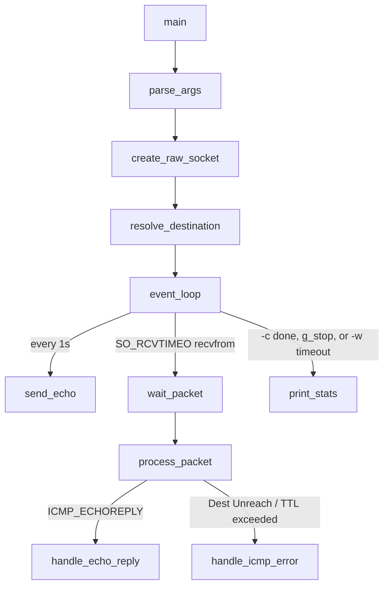
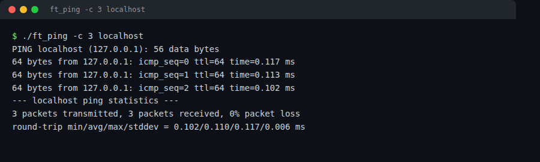
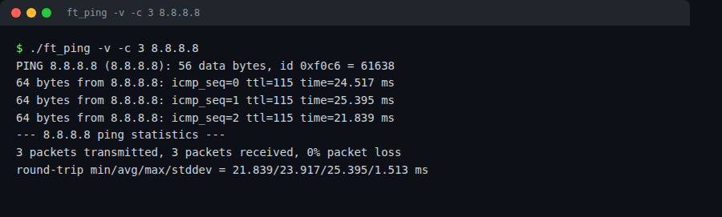
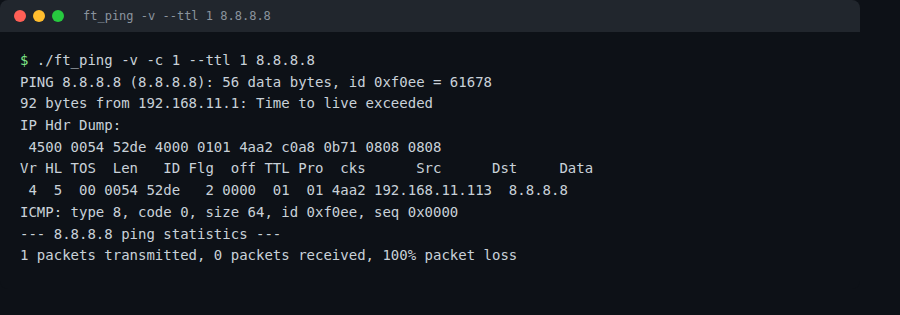

# ft_ping

A `ping` clone for Linux, built from scratch over raw ICMP sockets, output-compatible with GNU
`inetutils-ping`.


## Why this exists

`ping` is a 50-line idea (send ICMP echo, wait, print RTT) that is actually full of small, easy to
miss correctness traps: event timing without `poll`, ICMP error packets that quote your own
request back at you, checksums that fail silently on the wrong endianness. This is a 42/1337
school project (subject: match `inetutils-2.0`'s `ping`, no use of its source) that treats
"matches the reference" as a testable claim, not a feeling: `make test-docker` builds the real
`inetutils-2.0` and `inetutils-2.6` ping from GNU source and diffs ft_ping against both, byte for
byte, over ~25 cases.

## How it works



No `poll`/`select` anywhere (the subject forbids them): the event loop computes the remaining
wait each pass and blocks on a single `recvfrom()` with `SO_RCVTIMEO` instead.

## Quick start

Verified by running it, from a clean build, just now:

```sh
make                                  # 0.85s, zero warnings (-Wall -Werror -Wextra)
sudo setcap cap_net_raw+ep ft_ping    # or run with sudo each time
./ft_ping -c 3 localhost
```

```
PING localhost (127.0.0.1): 56 data bytes
64 bytes from 127.0.0.1: icmp_seq=0 ttl=64 time=0.117 ms
64 bytes from 127.0.0.1: icmp_seq=1 ttl=64 time=0.096 ms
64 bytes from 127.0.0.1: icmp_seq=2 ttl=64 time=0.090 ms
--- localhost ping statistics ---
3 packets transmitted, 3 packets received, 0% packet loss
round-trip min/avg/max/stddev = 0.090/0.101/0.117/0.012 ms
```

### Flags

| Flag | Description |
|------|-------------|
| `HOST` | Hostname or IPv4 address |
| `-v`, `--verbose` | ICMP id in the header line, IP header dump on ICMP errors |
| `-?`, `-h`, `--help` | Display help |
| `-c`, `--count=NUMBER` | Stop after sending NUMBER packets |
| `-w`, `--timeout=N` | Stop after N seconds |
| `-W`, `--linger=N` | Seconds to wait for a response after the last packet (default 10) |
| `--ttl=N` | Set IP time-to-live |
| `-r`, `--ignore-routing` | Send directly to a host on an attached network (`SO_DONTROUTE`) |
| `-n`, `--numeric` | Accepted for compatibility (addresses are never reverse-resolved) |

## Tests

```sh
make test-docker
```

Builds a Debian bookworm image with `inetutils-2.0` and `inetutils-2.6` compiled from GNU source,
then diffs ft_ping against each (stdout, stderr, exit status) for every case on the grading scale:
argument errors, good/bad IP and hostname, `-v`, TTL-exceeded over a real route, Ctrl+C mid-run,
and the bonus flags. Only the allowed differences are normalized away: `time=` values, the
round-trip line, reverse DNS names, and per-run ids/checksums.

Run one reference by hand inside the test image:

```sh
docker run --rm -it --cap-add=NET_RAW ft_ping-test bash
ping -v --ttl 1 8.8.8.8      # inetutils 2.0
ft_ping -v --ttl 1 8.8.8.8
```

## Notable bits

- **No `poll`/`select`, on purpose.** `src/loop.c` drives `-c`/`-w`/`-W`/Ctrl+C timing off one
  blocking `recvfrom()` with `SO_RCVTIMEO`, recomputing the remaining wait each pass.
  `test-diff.sh` greps the source for `poll|ppoll|fcntl|select` as an actual test case.
- **ICMP errors are verified, not trusted.** A Dest-Unreachable or Time-Exceeded packet quotes the
  original IP+ICMP header back; `handle_icmp_error` (`src/packet.c`) checks dest address, protocol
  and ICMP id match our own request before printing anything, so a stray error for someone else's
  traffic is silently dropped.
- **Reference-diffed, not just "looks right".** `Dockerfile.test` builds both `inetutils-2.0` and
  `inetutils-2.6` from source; `test-diff.sh` runs ~25 cases against each and diffs stdout, stderr
  and exit code.
- 808 lines of C total (`src/` + `include/ft_ping.h`), 7 source files, builds clean under
  `-Wall -Werror -Wextra` in under a second.

## Screenshots

| Case | What it shows |
|------|---------------|
|  | `ft_ping -c 3 localhost`: basic loop, stats line |
|  | `ft_ping -v -c 3 8.8.8.8`: `-v` id in the header, real-world RTT |
|  | `ft_ping -v --ttl 1 8.8.8.8`: ICMP Time-Exceeded, `-v` IP header dump |

## Files

```
include/ft_ping.h   project header
src/main.c          setup: socket, resolve, header line, exit status
src/args.c          command line parsing and validation
src/loop.c          send/receive loop (interval, linger, timeout, Ctrl+C)
src/packet.c        echo request build, reply and ICMP error parsing/printing
src/resolve.c       DNS resolution
src/checksum.c      ICMP checksum
src/stats.c         statistics
Dockerfile.test     test image (bookworm + inetutils 2.0 and 2.6)
test-diff.sh        diff-based test suite
```
